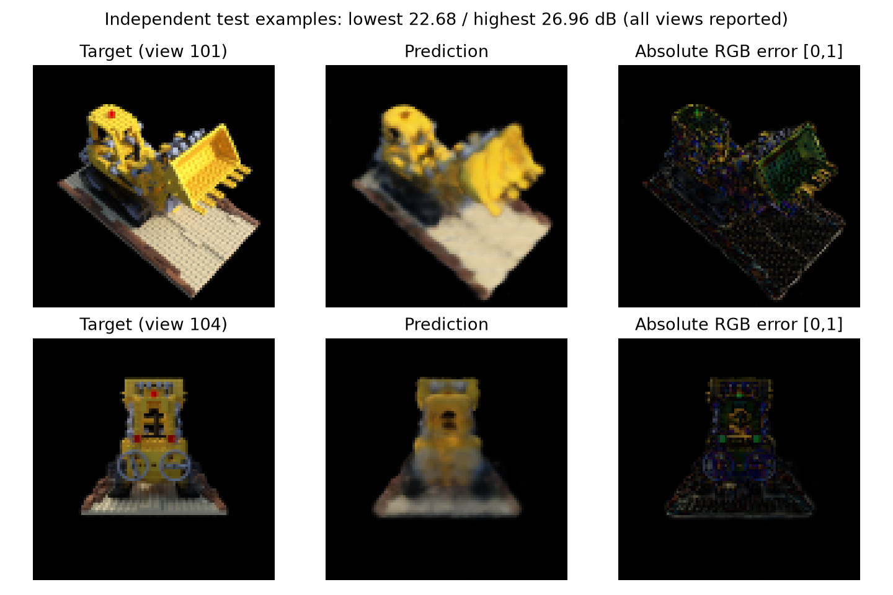
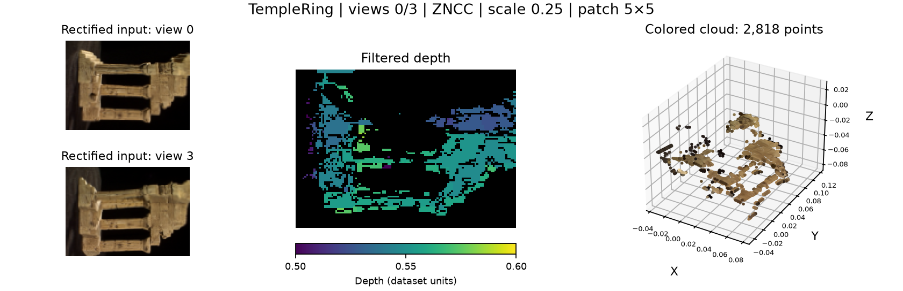

# 3D Reconstruction and Neural Rendering

A reproducible computer-vision project combining calibrated stereo reconstruction and a PyTorch NeRF. Developed from University of Pennsylvania CIS 5800 coursework, with camera-convention audits, validation-selected training, independent-view evaluation, and controlled experiments.

## Main result

<a href="docs/assets/research/test.png"></a>

Target, prediction, and absolute RGB error for the lowest- and highest-scoring test views. **NeRF metrics below are averaged over six held-out 100×100 views of one synthetic Lego scene**, after checkpoint selection on a separate validation set. All six per-view scores and failure cases are reported.

<a href="docs/assets/research/stereo_overview.png"></a>

**Stereo — Middlebury TempleRing:** rectified input views 0/3, ZNCC, image scale 0.25, 5×5 patches, and depth filter (0.5, 0.6) in dataset units. The depth map and **2,818-point** cloud use the same saved filtering result. No depth accuracy is claimed. [Full configuration and metrics](docs/results/research/stereo.json).

## Core features

- Audited camera rays, positional encoding, and finite-interval volume rendering; original implementation retained as a traceable baseline.
- GPU NeRF training with disjoint training/validation/test views, validation-based checkpoint selection, PSNR/SSIM, training curves, and error images.
- Controlled three-seed 2D encoding study and a separate, fixed-checkpoint **render-only** ray-sampling study.
- SSD/SAD/ZNCC stereo comparison under matched settings, including runtime, filtered depth coverage, left–right consistency, and colored PLY point clouds.

## Results

| Experiment | PSNR | SSIM | Evaluation scope |
|---|---:|---:|---|
| NeRF, 32 samples/ray | **24.19 dB** | **0.831** | Six independent 100×100 test views; one scene |
| 2D encoding L=0 | 20.59 ± 0.25 dB | 0.652 | Input-image fitting; three seeds |
| 2D encoding L=2 | 26.08 ± 0.01 dB | 0.802 | Input-image fitting; three seeds |
| 2D encoding L=6 | 31.97 ± 0.37 dB | 0.908 | Input-image fitting; three seeds |

NeRF: 20,000 training steps on an RTX 4070 Ti, approximately 104 seconds including validation. Encoding ± values are sample standard deviations across seeds. Stereo reports coverage and consistency, **not depth accuracy**, because local depth ground truth is unavailable.

## Installation and quick start

Tested with Python 3.12 on Windows. PowerShell, from the repository root:

```powershell
python -m venv '.venv'
& '.\.venv\Scripts\python.exe' -m pip install torch --index-url 'https://download.pytorch.org/whl/cpu'
& '.\.venv\Scripts\python.exe' -m pip install -e '.[dev]'
& '.\.venv\Scripts\python.exe' -m pytest -q

# Prepare inputs from your authorized local course archive; inputs are not in Git.
& '.\.venv\Scripts\python.exe' 'scripts/prepare_data.py' --zip 'C:\path with spaces\HWs&Project.zip'
& '.\.venv\Scripts\python.exe' -m vision5800 stereo
& '.\.venv\Scripts\python.exe' -m vision5800.research benchmark --output 'outputs/benchmark'
```

For GPU training, install a compatible CUDA PyTorch build instead of the CPU build. The verified GPU environment is recorded in [requirements-gpu-lock.txt](requirements-gpu-lock.txt). Then run:

```powershell
& '.\.venv\Scripts\python.exe' -m vision5800.research train --output 'outputs/my_nerf'
& '.\.venv\Scripts\python.exe' -m vision5800.research test --run 'outputs/my_nerf' --output 'outputs/my_test'
```

Configuration: [configs/nerf_formal.json](configs/nerf_formal.json). Use a fresh output directory for each run. Datasets, archives, checkpoints, and generated run outputs stay local; only selected figures and small metric records are versioned.

## Course origin and extensions

CIS 5800 supplied the task, data, camera calibration, architecture, and framework. Extensions include an image-y ray-sign correction, analytic rendering tests, reproducible training and evaluation, and controlled comparisons, developed with coding-assistant support. This is a course-project reproduction and experimental extension. See [provenance](docs/PROVENANCE.md) and [release/data notes](docs/PUBLICATION_REVIEW.md).

## Detailed experiments

- [Experiment report: protocol, hardware, results, failure analysis, and commands](docs/EXPERIMENT_REPORT.md)
- [Camera/rendering audit and preserved baseline](docs/AUDIT.md)
- [Raw experiment metrics](docs/results/research/)
- [Live project page](https://yixiaoliu.me/projects/3d-reconstruction-neural-rendering/) — figures, demonstrations and limitations
