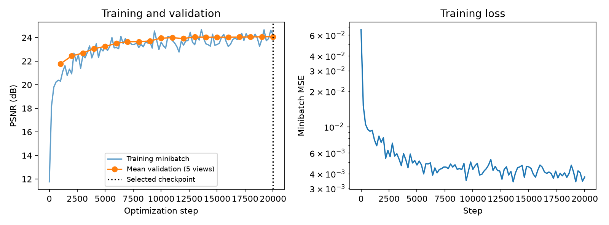
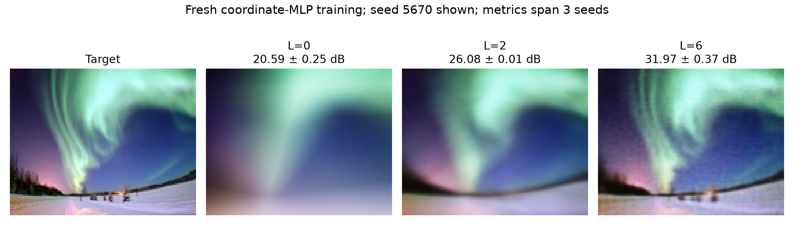
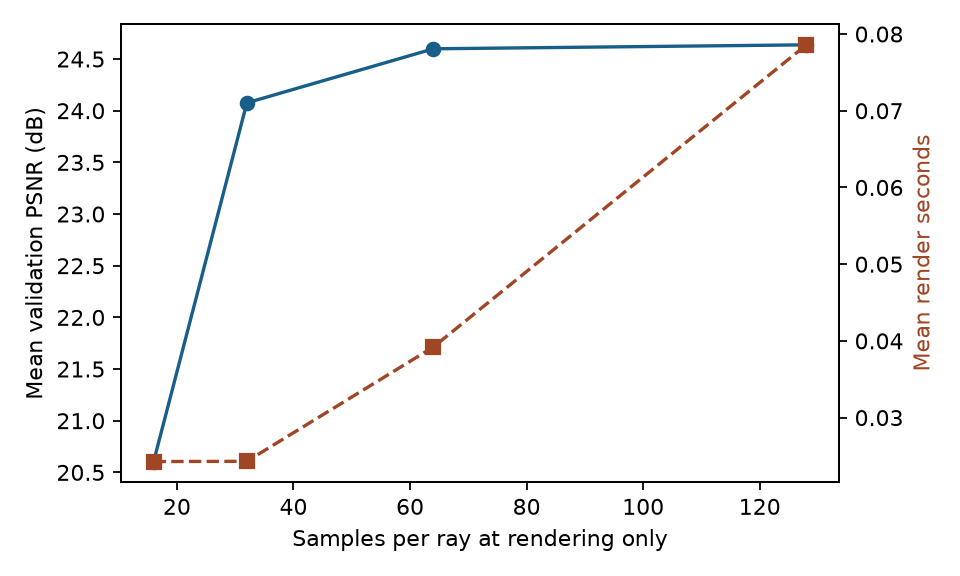
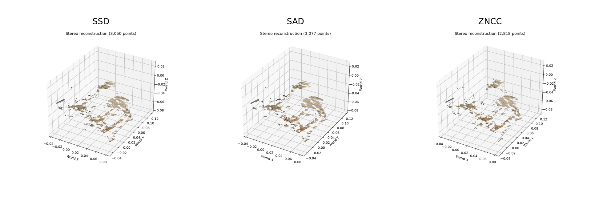

# Calibrated Stereo and Audited Neural Rendering

University of Pennsylvania CIS 5800 course project · Reproduction and experimental extension · 2026-10-17

Public source release authorized by the owner on October 24, 2026; raw datasets and checkpoints are excluded. See [release/data notes](PUBLICATION_REVIEW.md) and the [live project page](https://yixiaoliu.me/projects/3d-reconstruction-neural-rendering/). This is a static-scene reconstruction project with known camera calibration, not SLAM or a dynamic world model.

## Scope and contribution

The course supplied the task, data, camera calibration, network architecture and framework. The supplied student files contain implementations but authorship of every line is not established by file presence. This extension, built with coding-assistant support, audits conventions, repairs the image-down ray sign, preserves the baseline, adds validation-selected training, independent evaluation, matched experiments and reproducible reporting. These engineering and experimental contributions do not constitute an original reconstruction algorithm. Personal resume claims should reflect work the applicant can explain and defend.

## Audit and baseline

The original implementation is retained at commit `5c29239` and in `src/vision5800/baselines/`. Legacy CLI inference still uses original rendering. In 412 cross-view SIFT matches, the known-pose median Sampson distance was 0.145 px for positive image-down y and 1.074 px for the previous negative sign. +Z already points toward the scene; it was retained. Encoding was consistent. New experiments also use midpoint samples, finite [.667,2.0] integration, black residual background and softplus density. These choices differ from the baseline's endpoint samples, infinite terminal interval and ReLU density; comparisons are not single-variable causal claims. Unit tests verify camera reprojection, finite analytic opacity, gradients and baseline behavior.

## Compute and fixed protocol

Hardware: NVIDIA GeForce RTX 4070 Ti, 12.0 GiB VRAM; 13th Gen Intel(R) Core(TM) i7-13700K; 31.7 GiB RAM. Python 3.12.14, PyTorch 2.7.1+cu128, CUDA 12.8. Float32, no mixed precision; seed 5670. Exact environment, dataset/checkpoint SHA-256 and full configuration are recorded in results/research.

A pre-training 100-step benchmark confirmed the run was affordable (conservative estimate 3.3 minutes). Its timer initially included post-loop metadata overhead; that timing issue was fixed and a post-run repeat with a 10-step warmup measured 0.0051 s/training step, or 1.7 projected optimization minutes excluding validation/setup. Both records are retained. The completed run took 1.7 minutes including validation/checkpoint writes; peak allocated GPU memory was 0.25 GiB.

NeRF: 128-wide eight-layer position trunk, skip connection and direction-conditioned RGB head; position/direction frequencies 6/3; 32 samples/ray; 1024 random rays/step, sampled across 90 training views; Adam starts at 0.0005, decays as 0.1^(step/10000). Images remain 100×100. Training is views 0–89; validation 90/92/94/96/98; independent evaluation 100–105; other views unused. Validation every 1000 steps chooses maximum mean PSNR; selected step 20000. The six test views did not select weights or rendering settings. Legacy experiments had previously inspected some images; disjointness applies to this fresh model, not an external untouched benchmark.



## Independent test results

Mean per-view PSNR **24.19 dB**, mean SSIM **0.831**, using the fixed 32-sample renderer. PSNR uses RGB MSE in [0,1], averaged as per-view dB. SSIM uses 11×11 Gaussian windows (sigma 1.5), population covariance, K1=.01/K2=.03, valid 5-pixel crop and RGB-channel averaging. Six views of one synthetic scene are a small evaluation; no real-world generalization is claimed.

| Test view | PSNR (dB) | SSIM |
| --- | --- | --- |
| 100 | 22.95 | 0.840 |
| 101 | 22.68 | 0.777 |
| 102 | 24.15 | 0.833 |
| 103 | 24.55 | 0.838 |
| 104 | 26.96 | 0.866 |
| 105 | 23.84 | 0.829 |


## Controlled experiment 1: position encoding

Fresh 2D fits use L=0/2/6, three fixed seeds, 2000 steps, batch 1024, Adam 5e-4, width 128, identical target/resolution and minibatch stream per seed. The first-layer parameter count grows with encoding dimension. Metrics below are input-image reconstruction, not held-out generalization; ± is sample standard deviation across three seeds. Historical supplied checkpoints are excluded from this controlled comparison.

| Frequency | Mean PSNR ± SD | Mean SSIM |
| --- | --- | --- |
| L=0 | 20.59 ± 0.25 | 0.652 |
| L=2 | 26.08 ± 0.01 | 0.802 |
| L=6 | 31.97 ± 0.37 | 0.908 |



## Controlled experiment 2: samples per ray

**Rendering-only**: the selected 32-sample-trained model is frozen; only inference samples vary. All five validation views, resolution, bounds, weights and camera convention are fixed. No retraining occurs. Timings use GPU synchronization and one warmup; they are local measurements, not production throughput benchmarks. The final test renderer remains predeclared at 32 samples regardless of this table. This experiment does not support conclusions about changing samples during training.

| Render samples | Val PSNR | Val SSIM | Mean seconds/view |
| --- | --- | --- | --- |
| 16 | 20.60 | 0.717 | 0.024 |
| 32 | 24.08 | 0.813 | 0.024 |
| 64 | 24.60 | 0.826 | 0.039 |
| 128 | 24.64 | 0.827 | 0.079 |

In this measured setting, 64 samples improves mean validation PSNR over 32; 128 adds only 0.04 dB over 64 while increasing render time from 0.039 to 0.079 seconds/view. At these tiny image sizes, launch/chunk overhead can dominate the 16-versus-32 timing comparison. These are local observations, not universal optimal settings.



## Stereo comparison

SSD/SAD/ZNCC use the same three pairs (0/3, 2/4, 13/15), scale .25, patch 5, rectification padding 20, depth window (.5,.6), HSV threshold 45, closing kernel 11, statistical filtering k=10/std=2 and supplied calibration. Three repeats per pair; median matching+depth+filter time excludes common rectification and output IO. Table averages per-pair values; point counts sum the three separate results (not fused/unique geometry). All ratios use every pixel in each identical rectified canvas, including background/padding. Positive-depth fraction is 100% by construction because matching is constrained to positive disparity; final filtered coverage is the meaningful reported quantity. LR consistency is not correctness.

| Kernel | Median sec/pair (mean) | LR pass | Final depth coverage | Total points |
| --- | --- | --- | --- | --- |
| SSD | 0.411 | 48.8% | 31.1% | 9631 |
| SAD | 0.414 | 48.0% | 30.9% | 9590 |
| ZNCC | 0.298 | 42.8% | 30.6% | 9486 |



No local ground-truth depth is available, so **no depth accuracy is reported**. Runtime, coverage and consistency describe different tradeoffs and do not identify the most accurate kernel.

## Failure cases and limitations

Test view 101 is the lowest-scoring view (22.68 dB / SSIM 0.777); its image/error panel is shown rather than hiding it. Inspect thin structures, edges and specular surfaces for remaining artifacts. The model uses one scene, known poses and no hierarchical sampling. Finite training and coarse quadrature can miss details; validation selection does not guarantee external generalization. Stereo has holes, outliers and scene-specific filtering; lower coverage may reject wrong matches or discard valid ones. No geometric accuracy, autonomous robot deployment or novel algorithm is established. NeRF has one training seed; only the 2D study measures seed variability.

## Reproduce

From the repository root with its environment installed:

```powershell
.\.venv\Scripts\python.exe scripts/audit_coordinates.py
.\.venv\Scripts\python.exe -m pytest -q
.\.venv\Scripts\python.exe -m vision5800.research benchmark --output outputs/nerf_benchmark
.\.venv\Scripts\python.exe -m vision5800.research train --output outputs/formal_nerf
.\.venv\Scripts\python.exe -m vision5800.research test --run outputs/formal_nerf --output outputs/formal_test
.\.venv\Scripts\python.exe -m vision5800.research sample-sweep --run outputs/formal_nerf --output outputs/sample_sweep
.\.venv\Scripts\python.exe -m vision5800.research image --output outputs/image_controlled
.\.venv\Scripts\python.exe scripts/compare_stereo.py
.\.venv\Scripts\python.exe scripts/build_research_report.py
```

The training command starts fresh, never loads supplied weights. Re-running it replaces that output run, so use a new folder to preserve a run. Dataset preparation remains local; see README and PUBLICATION_REVIEW.md. Raw metrics: [test](results/research/test.json), [training](results/research/run.json), [stereo](results/research/stereo.json), [encoding](results/research/image.json), [sampling](results/research/sample_sweep.json).
