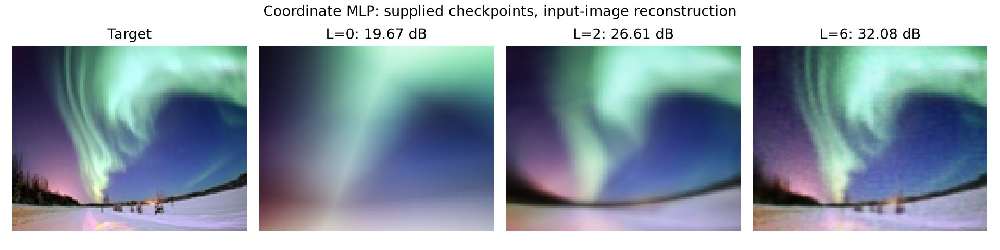
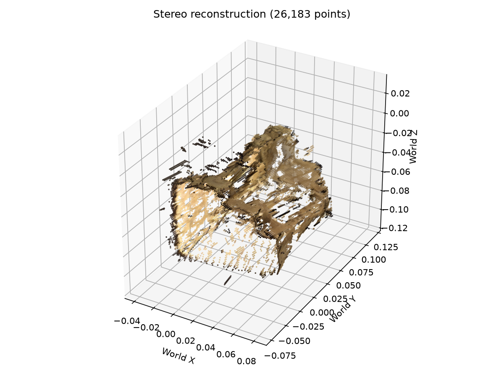
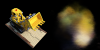
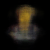

# Historical reproduction record — October 12, 2026

This record covers the earlier CPU checks of the supplied implementations and
weights. The later coordinate correction, formal training and independent test
evaluation are in the [experiment report](EXPERIMENT_REPORT.md).

Environment: Windows, Python 3.12.14 and CPU PyTorch; exact versions are in
`requirements-lock.txt`.

## Executed checks

- Six tests: relative-pose consistency, depth reprojection, known-translation
  matching, camera rays, empty/opaque volume rendering and gradients, chunking.
- Default stereo: ZNCC, 5×5 patches, scale 0.25, views 0/3.
- Nine-pair aggregation from the original notebook: SAD, 5×5 patches, scale 0.25.
- Three supplied input-image MLP checkpoints evaluated.
- Supplied NeRF weights evaluated on view 101 at 100×100, 64 samples.
- Five-step random-initialization training smoke checks for 2D and NeRF, with
  weight/image export.
- Eight-pose NeRF GIF rendered at 50×50.

| Experiment | Result | Interpretation |
|---|---:|---|
| Stereo ZNCC, views 0/3 | 2,818 points | Filtered point count |
| Nine-pair SAD aggregation | 26,183 points | Separate view results; not deduplicated or meshed |
| 2D MLP L=0 | 19.67 dB | Input-image fitting |
| 2D MLP L=2 | 26.61 dB | Input-image fitting |
| 2D MLP L=6 | 32.08 dB | Input-image fitting |
| Supplied NeRF weights, view 101 | 15.77 dB | Quality on the original model-selection view |

Detailed records are in `docs/results/*.json`; full images, NPZ, PLY, CSV and
smoke-check weights remain in local `outputs/`. CPU timings include loading and
concurrent-work effects, so the formal runtime protocol is reported separately.

## Visual observations

Higher-frequency 2D encoding retains more detail. Low-resolution stereo contains
outliers and incomplete surfaces. The supplied NeRF checkpoint is visibly blurry.
The GIF includes training poses; the six-view held-out benchmark belongs to the
later formal run. Full-resolution stereo and depth-ground-truth evaluation were
not performed in this historical run.
